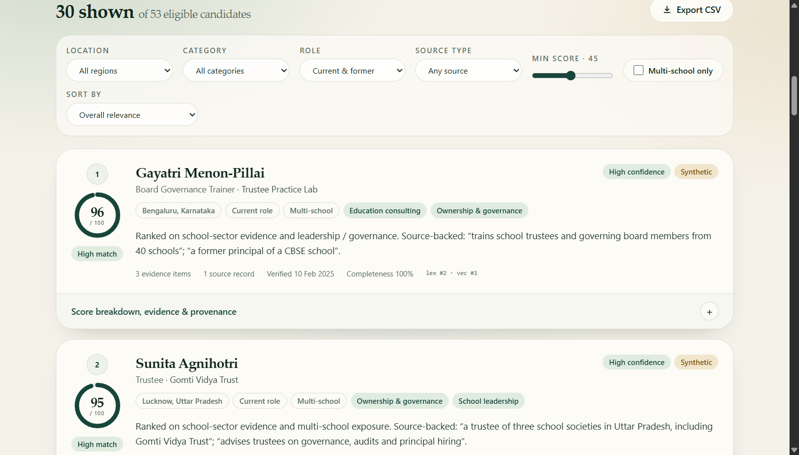

# EDXSO — School Influence Discovery Tool

Given **one reference professional**, discover and rank other professionals with **credible, evidence-backed
relevance to India's school-education ecosystem**. Every score is decomposable, every claim quotes its source,
and nothing is scraped.

> **Live: https://school-influencer.vercel.app** · **Data status: REAL public-source dataset** (`india-school-ecosystem-real-v1`, default).
> 22 real school principals, school-group, school-services and education-NGO leaders, each with the source page URL and
> excerpts verified verbatim on fetch (`scripts/build-real-dataset.ts`: pages from web search, Gemini extracts people from
> the fetched text only, 4 candidates rejected by the checks, see `build-report.json`). No LinkedIn, no contact details.
> The synthetic corpus (`DATASET_VERSION=india-school-ecosystem-v1`) is kept for the labelled evaluation harness.



*Real screenshot of the running app: 30 ranked professionals for the fictional reference, with filters, scores and evidence-quoting explanations.*

## Quick start

```bash
cp .env.example .env            # all values are safe local defaults
docker compose up -d db         # or use any local PostgreSQL 14+ matching DATABASE_URL
npm install
npx drizzle-kit push            # create tables
npx tsx scripts/seed.ts         # optional — the app also seeds itself on first request
npm run dev                     # http://localhost:3000
```

Production check: `npm run build && npm run start` (health: `GET /api/health`).

| Command | What it does |
|---|---|
| `npx tsx scripts/seed.ts` | Idempotent import of the versioned dataset + quality report |
| `npx tsx scripts/evaluate.ts [ref-id]` | Prints analysis, ranked list and evaluation metrics |
| `npx tsx scripts/export-dataset.ts` | Regenerates `data/datasets/<version>/*.csv` + `manifest.json` (SHA-256) |

## The 5-minute demo (repeatable)

1. Open **Demo** → run the designated reference (*Radhika Anantharam*, fictional).
2. Read **Step 1** — the structured interpretation; expand *Evidence spans* to see the text behind each indicator.
3. In the ranked list, open **Score breakdown, evidence & provenance** on any card.
4. Use filters (location, category, role status, source type, min score, multi-school) and sorts.
5. **Export CSV** (formula-injection safe).
6. Try *Profile URL* on the home form → the API refuses by design (policy gate).
7. **Evaluation** → keyword vs embedding vs hybrid on train / held-out splits.

## Architecture

Modular monolith (Next.js App Router + TypeScript + PostgreSQL via Drizzle). Python/FastAPI from the reference
design is replaced by Next.js route handlers so the whole system deploys as one service; the module boundaries
are the same.

```
src/
  data/india-school-ecosystem-v1.ts   versioned synthetic dataset (single source of truth)
  db/schema.ts                        persons · profile_sources · evidence_items · profile_embeddings ·
                                      profile_analyses · discovery_runs · discovery_results ·
                                      import_batches · ranking_configs · relevance_labels · correction_requests
  lib/
    taxonomy.ts      controlled vocabulary, claim rubric, synonym groups, gazetteer
    text.ts          normalisation, deterministic embedding, cosine, percentile calibration, tsquery builder
    analysis.ts      rule-based reference analyser (evidence spans, null-not-guess)
    seed.ts          validation → quarantine → entity resolution → evidence → embeddings → quality report
    pipeline.ts      lexical (Postgres FTS) + vector retrieval → RRF → eligibility filters → rank → persist
    ranking.ts       seven feature functions, renormalised weighted score, school-evidence gate, optional MMR
    explain.ts       evidence-quoting explanations validated against evidence ids
    evaluation.ts    P@K, Recall@K, nDCG@K, MRR, baselines, held-out split
    config.ts        versioned, validated ranking configuration
  app/api/v1/        REST contract (below)
  app/               / · /demo · /discover/[runId] · /candidates/[id] · /evaluation · /governance · /settings
```

### API

| Method & path | Purpose |
|---|---|
| `POST /api/v1/discovery-runs` | Create a run. Exactly one of `reference_profile_id` / `profile_text` (+`display_name`) / `profile_url` (refused: no authorised connector) |
| `GET  /api/v1/discovery-runs` · `/{id}` | Recent runs · run metadata, analysis, retrieval stats, versions |
| `GET  /api/v1/discovery-runs/{id}/results?limit&offset&sort&region&category&min&status&multi&source` | Paginated, filtered results with `score_components`, `explanation`, `evidence[]`, `sources[]`, `last_verified_at`, `data_completeness`, `warnings[]` |
| `GET  /api/v1/discovery-runs/{id}/export` | CSV of the displayed results |
| `GET  /api/v1/candidates/{id}` | Candidate detail, evidence, provenance, entity-resolution record |
| `GET/POST /api/v1/settings` | Ranking configs (immutable versions; optional `ADMIN_TOKEN`) |
| `POST /api/v1/corrections` | Correction / removal request queue |
| `GET  /api/v1/evaluation` | Live evaluation report |
| `GET  /api/health` | Health check |

Example:

```bash
curl -s -X POST localhost:3000/api/v1/discovery-runs \
  -H 'content-type: application/json' \
  -d '{"reference_profile_id":"demo-ref-001","limit":30,"filters":{"country":"India"}}'
```

## Method

1. **Analyse.** Deterministic rules extract role, organisation, geography, seniority, sector tags, school roles,
   exposure (`multi_school`, `school_group`, `school_adjacent`, `direct_single_school`, `unknown`), leadership and
   influence indicators — each with an evidence span. Missing fields are listed, never guessed.
2. **Retrieve.** Lexical: Postgres `to_tsvector`/`ts_rank_cd` with a synonym-expanded query (principal ↔ head of
   school, trustee ↔ governor, …). Semantic: cosine over a deterministic 512-d hashed-concept embedding. Top-50 each,
   merged by Reciprocal Rank Fusion (k = 60).
3. **Filter.** Self-match, no-source, no-evidence and out-of-geography records are removed and counted.
4. **Rank.** `Score = 100 · Σ wᵢxᵢ / Σ wᵢ` over *observable* features (missing data renormalised):

   | Feature | Weight | Notes |
   |---|---|---|
   | School ecosystem relevance (S) | 0.30 | max of evidence-claim rubric (1.0 → 0.0) |
   | Role/experience similarity (R) | 0.20 | 0.6·role-family overlap + 0.4·pool-calibrated responsibility similarity |
   | Multi-school exposure (M) | 0.15 | explicit multi-school/group 1.0 · network/portfolio 0.7 · cross-school activity 0.4 |
   | Leadership/governance (L) | 0.15 | owner/trustee/principal 1.0; school-facing org leader capped 0.7; discounted if S < gate |
   | Semantic similarity (E) | 0.10 | cosine → percentile within retrieval pool (monotonic calibration) |
   | Network/connector (N) | 0.05 | count of documented ecosystem claims |
   | Data confidence (C) | 0.05 | source authority, freshness vs dataset date, completeness, date clarity |

   **School-evidence gate:** if S < 0.25 the score is capped at 40, so a generic "Founder" or "Consultant" cannot rank
   highly on title alone. Ordering is stable: score ↓, confidence ↓, id ↑.
5. **Explain.** Deterministic templates quote the source excerpts of the two strongest evidenced components and
   cite evidence ids; an explanation that cannot be matched to its evidence is withheld.

An LLM is **not** used in this build (`LLM_PROVIDER=none`); the adapter boundary exists so a validated LLM
explainer can be added later without touching scoring.

### Embeddings, honestly

`pgvector` is not available in the target environment, and a Sentence-Transformers model would need a download and
Python runtime. The MVP therefore ships a **deterministic hashed-concept embedder** (`edxso-hash-concept-embed@v1.0.0`,
signed feature hashing over unigrams, bigrams and synonym-concept tokens). It captures lexical and concept overlap —
not world knowledge — and is versioned in `profile_embeddings` so it can be swapped and re-embedded. Vectors are
stored as `real[]`; for large corpora move to pgvector + an ANN index.

## Governance

- **No LinkedIn automation of any kind.** URL input is refused unless an authorised connector exists.
- Sources are stored separately from canonical people; merged records stay independently inspectable.
- Entity resolution needs name **and** organisation **and** region to match; same-name-only pairs are flagged, not merged.
- Evidence is a short literal excerpt, not a page copy. `profile_url` is only populated if a source supplies it.
- Correction/removal requests are queued via the UI/API. Retention schedule must be defined before production.
- API limits: JSON body size caps, zod validation, in-memory rate limiting (swap for a shared store when scaling).
- Logs avoid profile text and personal data.
- See `data/datasets/india-school-ecosystem-v1/README.md` for dataset origin, licence notes and limitations.

## Evaluation

`/evaluation` (or `GET /api/v1/evaluation`) reports P@5, P@10, Recall@20, nDCG@10 (gain 2^g−1) and MRR for
keyword-only, embedding-only and hybrid, on train and held-out splits, plus evidence coverage, duplicate rate and
unsupported-claim rate. Labels were assigned by the fixture author (single annotator), so treat numbers as a
demonstration of the harness. The 0.70 P@10 target is something to *measure on real labelled data*, not a result
to claim.

## Deploying

Any host that runs Node 20+ and PostgreSQL works. Set `DATABASE_URL`, run `npx drizzle-kit push`, then
`npm run build && npm run start`. The first request seeds the permitted demo dataset. Keep private datasets out of
the repository (`data/private/` is git-ignored) and never expose secrets via `NEXT_PUBLIC_*`.

## Known limitations

- Synthetic, small, easy corpus; weights are an uncalibrated hypothesis.
- Rule-based analyser is English-only and tuned to the vocabulary of school biographies.
- Single annotator; no inter-rater agreement.
- In-memory rate limiter is per-process.
- No authentication on read endpoints (demo scope); `ADMIN_TOKEN` guards configuration changes.
